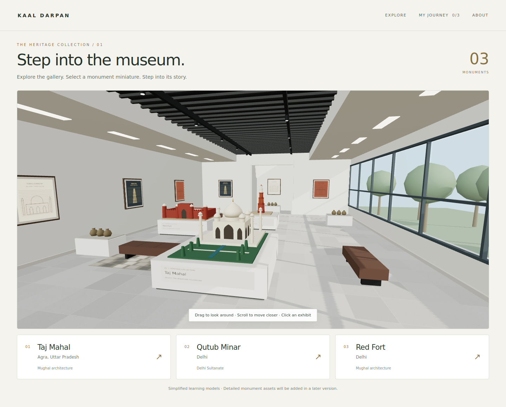

# Kaal Darpan — museum development stage

Kaal Darpan opens with its animated heritage cover. The **GPS** button opens a separate interactive MapLibre atlas of North India, which leads into the Three.js gallery and monument experiences with architecture hotspots, timelines, activities and saved learning progress.

## Open it

Extract the ZIP and open the `kaaldarpan_merged` folder (the folder containing `package.json`) in VS Code. If you opened the parent folder instead, first run `cd .\kaaldarpan_merged` in the terminal. Then run:

    npm install
    npm run dev

Open http://localhost:5175 for the Kaal Darpan entrance (React, mounted from `src/main.jsx`). Choose **GPS** to open the atlas, **Back** to return to the entrance, or **Museum** to go directly to the 3D gallery. Select a featured monument and choose **Open monument** to view its interactive timeline. Keep the terminal running. If port 5175 is already occupied by your old project, stop the old server with Ctrl+C first.

Use the map to locate monuments, zoom and rotate the view, or select **Use my location** to filter nearby landmarks. Location is requested only after you press the button. The atlas basemap uses OpenStreetMap tiles and requires an internet connection. Use the appearance control to switch themes; your selection is saved in this browser.

The downloaded ZIP intentionally excludes node_modules. npm install recreates it correctly for your computer.

The English/Hindi/Tamil language selector is available on the homepage, GPS atlas, gallery, monument timeline and notes/quiz page. The selected language is saved in this browser.

## Gallery design

The gallery uses white rectangular display tables, a tiled stone-style floor, full-height windows, a dark slatted ceiling with perimeter lighting, wall-mounted heritage illustrations, benches and small object exhibits. Its five monument displays are the Taj Mahal, Red Fort, Qutub Minar, Jantar Mantar (Delhi) and Humayun’s Tomb. Each has a timeline and learning experience. The gallery is modeled in 3D; the reference photo is not used as a flat background.

Drag to look around within the room and scroll/pinch to move closer. Select a miniature, its display table, or the accessible monument card to enter that monument.

## Try it

Choose GPS or enter the Museum → explore any of the five gallery models → open its monument timeline → drag to rotate and scroll/pinch to zoom → select a numbered marker or feature button to zoom to that detail → use Season at the lower left to preview moving clouds, falling rain, sunrise, sunset or starry-night lighting and monument colours → open Weather beside the timeline for live local conditions and a five-day visit recommendation → History → Challenge → answer the questions and check answers → return to the GPS atlas or Museum → My Journey.

The exhibit cards and feature buttons provide keyboard access to the same content as 3D clicking. Visitor mode is also available on the notes and quiz page; click the model to focus it, drag to look, use W/A/S/D to walk, and Shift to move faster. The learning panel includes Architecture, History, Challenge and an Additional info tab with source-based heritage notes and real, attributed Wikimedia Commons photographs for the Taj Mahal, Qutub Minar, Red Fort, Jantar Mantar and Humayun’s Tomb. Photo captions link to the original file and its license. The Weather tab shows current conditions for the monument's city and identifies the best day to visit from the five-day forecast. Forecasts are supplied by OpenWeather and refresh every 15 minutes while the tab is open. The monument grounds also include garden trees and greenery. Reset View restores the camera. R also resets it when the canvas is focused.

## Scope

Models are procedural educational reconstructions, not measured surveys. The Jantar Mantar model now distinguishes the inclined Samrat Yantra, open paired Ram Yantras, concave Jai Prakash bowls and the Misra Yantra group, while retaining schematic site placement and proportions. Use POI photographs and the cited historical references alongside the models; no model should be treated as dimensionally exact. This stage supports looking around the museum and orbiting monuments; walking through interiors, production Blender/GLB models, QR scanning, accounts, Firebase and AR/prism display are not implemented. Progress is stored in localStorage for the same browser and origin; it does not sync between devices. If storage is blocked the app remains usable for the session.

## Museum guide chatbot

The museum guide grounds answers in the exhibit notes in `src/data.js` and the keyword and intent guide in `server/chatbot_training_keywords.json`. Gemini Flash Lite is the primary provider; Sarvam is available as a fallback. The guide recognizes aliases, spelling variants, Hindi/Hinglish terms, question intents, and the dataset's disambiguation guidance. This is prompt-based grounding, not model fine-tuning. The supplied file is a keyword index that refers to a separate 300-question answer document; that answer document is not included, so the chatbot must not invent unsupported answers.

Set `GEMINI_API_KEY` in the ignored project-root `.env.local` file to enable chat. Optionally set `SARVAM_API_KEY` there to enable the Sarvam fallback and Hindi/Tamil narration. Restart the Vite server after changing environment variables. The guide will not answer changing ticket, timing, or closure details from the keyword list; it directs visitors to the official ASI source.

Set `OPENWEATHER_API_KEY` in the same ignored `.env.local` file to enable live weather, then restart the Vite server. Weather requests are proxied through the server so the key is not exposed to the browser.

## Sarvam chat smoke test

Set `SARVAM_API_KEY` in `.env.local` or the process environment. To make one chat completion request using `sarvam-105b-conversations` and print its reply, run:

    npm run sarvam:chat

The script reads the key only from the environment file or process environment and reports an error if it is unset. Do not commit environment files or print the key.

## Files

- index.html: single Vite entry; mounts the React app (cover → GPS atlas / hall → monument) from `src/main.jsx`.
- museum.html: thin redirect to `/` (keeps old links working; `museum.html#gallery` → `/#gallery` opens straight into the hall)
- src/App.jsx: entrance, navigation, transition, learning panels, quiz, progress
- src/Scene.jsx: renderer, controls, picking, projected markers, cleanup
- src/models.js: procedural monument and museum builders
- src/data.js: monument content, hotspots, quiz and source URLs
- src/App.css and src/index.css: styling

## References

Historical content was checked against UNESCO monument descriptions. Simplified model observations are explicitly marked. Content should be reviewed alongside measured assets before a full educational release.

- Taj Mahal: https://whc.unesco.org/en/list/252/
- Qutb Minar and its Monuments: https://whc.unesco.org/en/list/233/
- Red Fort Complex: https://whc.unesco.org/en/list/231/
- Humayun’s Tomb: https://whc.unesco.org/en/list/232/
- Jantar Mantar (Delhi): https://asi.nic.in/pages/Monuments

## Build

    npm run build
    npm run lint

Node.js: use a version supported by the project's Vite dependency. The gallery does not need a database; Gemini chat, Sarvam fallback/Hindi and Tamil narration, live weather and the Sarvam smoke test use `GEMINI_API_KEY`, `SARVAM_API_KEY` and `OPENWEATHER_API_KEY` as described above.

## Narration audio

English narration across the timeline and museum history pages is served only from bundled audio files in `public/narration`, including the voice/pronunciation preview. Most are MP3s; the Jantar Mantar timeline clips are WAV files generated with the local Microsoft David voice. English playback has no server endpoint or third-party API fallback. Keep the audio files and `manifest.json` in the project and deploy them with the static site. Verify the English bundle with `npm run narration:bundle -- --language=en --verify`.

Hindi and Tamil narration use Sarvam translation and speech synthesis and require `SARVAM_API_KEY` with available account credits when generated. The app’s English/Hindi/Tamil language toggle also sets the narration language; if audio is already playing, it restarts in the selected language. Generate the Hindi and Tamil audio bundles with `npm run narration:bundle`; generation resumes from the existing manifest, and once generated, playback uses the local clips like English. If Sarvam reports that credits are exhausted, add credits or use a key from an account with credits, then rerun the command. Timeline narration is enabled by default and can be switched off in narration settings. Keep provider credentials server-side in `.env.local` and out of frontend code.

POI descriptions, construction phases, historical events, later-history summaries, monument notes, museum history summaries, and the pronunciation preview have audio. Opening a panel never starts playback. The narration generator resumes from the manifest and can generate Hindi and Tamil clips through Sarvam; it does not generate English audio. Run `npm run narration:bundle -- --verify` to check all three language bundles, or pass `--language=hi-IN` or `--language=ta-IN` to generate or verify one language.

Hindi, Urdu and Persian heritage terms are converted to Devanagari for the English narration voice in `src/viewer/pronunciation.js`; use the **Test voice and pronunciation** control in narration settings to audition the lexicon. The test covers the monument names and terms in the exhibit content. Set `PRONUNCIATION_MODE` in that module to `'respell'` to use its English-letter fallback globally. When narration text or pronunciation entries change, update the English audio files and manifest in `public/narration` with the project assets.
